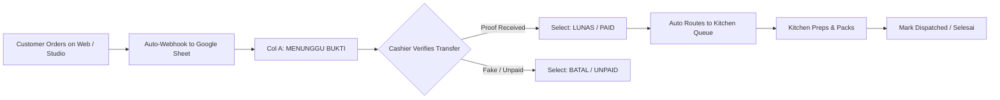

# 🥣 SMOOTHIE THERAPY — Standard Operating Procedures (SOP) & Recipe Manual
**Version:** 1.0 (Live Kitchen & Atelier)  
**Location:** Crisp & Bowl Atelier / Smoothie Therapy  
**Google Sheet POS:** [Live Order Pipeline](https://docs.google.com/spreadsheets/d/1QYlWAJu95TnxnsKPjKj5TH7tuWENkgXEFNCsn19GLvU/edit)  
**Order Dispatcher:** [Local Kitchen Portal](http://localhost:8080/order-manager.html)  

---

## 1. 🌿 Brand Philosophy & Daily Standards
*Smoothie Therapy* is dedicated to clean, functional nutrition made from 100% natural, fresh ingredients without artificial sweeteners, syrups, or preservatives.

### Opening Routine (07:30 - 08:30)
1. **Sanitization**: Wipe all food preparation tables with food-safe sanitizer.
2. **Temperature Check**:
   - Freezer (Smoothie Bases): -18°C to -15°C
   - Salad Chiller (Vegetables & Protein): 2°C to 4°C
3. **App & POS Readiness**:
   - Open [Google Sheet POS](https://docs.google.com/spreadsheets/d/1QYlWAJu95TnxnsKPjKj5TH7tuWENkgXEFNCsn19GLvU/edit) on the kitchen tablet.
   - Open [Order Dispatcher](http://localhost:8080/order-manager.html) (PIN: `2026`).
   - Check WhatsApp Business connection for customer incoming tickets.

---

## 2. 🥗 Studio 1: Wrap & Salad Atelier Standards

### Core Construction Sequence
1. **Base Layer (35% volume)**: Crisp Romaine, Mixed Baby Greens, or Quinoa Rice.
2. **Fresh Fillings (30% volume)**: Edamame, Cherry Tomatoes, Purple Cabbage, Cucumber ribbons, Roasted Corn.
3. **Premium Protein (25% volume)**: Herb Grilled Chicken Breast, Sous-vide Smoked Salmon, Pan-seared Tofu.
4. **Crunch & Texture (5% volume)**: Toasted Pumpkin Seeds, Roasted Almond slivers, Garlic Crisps.
5. **Dressing (5% volume - served on side or lightly tossed)**: Honey Dijon, Creamy Caesar, Lemon Tahini, or Sesame Ginger.

### Temperature & Freshness Rules
- Toss greens strictly in cold stainless bowls.
- Dressings must be stored in squeeze bottles labeled with preparation dates (Shelf life: 3 days max).

---

## 3. 🍓 Studio 2: Smoothie Bowl Atelier Standards

### Base Blend Formula (Yield: 1 Regular Bowl)
* **Dragon Boost**: 120g frozen red pitaya, 80g frozen banana, 60ml unsweetened almond milk. (Blend on HIGH for 40s until thick soft-serve consistency).
* **Green Immunity**: 100g frozen mango, 60g spinach, 1/2 avocado, 70ml cold-pressed coconut water.
* **Berry Acai Glow**: 100g organic acai puree, 80g frozen blueberries, 50ml oat milk.

### Topping Placement Sequence
- **Zone 1 (Top Left)**: Sliced banana fans & halved strawberries.
- **Zone 2 (Top Right)**: Organic chia seeds & hemp hearts.
- **Zone 3 (Bottom Left)**: Golden granola cluster (crunch layer).
- **Zone 4 (Center/Drizzle)**: 1 tbsp pure almond butter or raw blossom honey ribbon.

---

## 4. 📲 Live POS & Payment Verification Protocol

### Action Guidelines:
* When a customer places an order, it appears in **Tab 1: Konfirmasi Pembayaran** within 1 second.
* Once the cashier confirms the bank transfer / QRIS payment, change **Status** to `LUNAS / PAID`.
* **Tab 2: Pesanan Lunas (Kitchen)** will immediately display the ticket for kitchen staff to assemble.
* When testing or clearing old orders, select `🗑️ HAPUS / CLEAR` or use the **Hapus** button in the Order Dispatcher portal.

---

## 5. 📞 Emergency & Service Contacts
- **Store Manager**: +62 812-3456-7890
- **Store Email**: ngkobun@gmail.com
- **Google Drive Hub**: [Smoothie Therapy Google Drive](https://drive.google.com/drive/folders/1Qpx3xrluR_zhkq5SnjGMPc2soq1reGdS)
